# Dodol Arulla — Showcase

Screenshot hasil kerja untuk **Dodol Arulla**, produsen dodol rumahan. Proyek berbayar,
sudah tayang di **[dodolarulla.store](https://dodolarulla.store)**.

Repo ini **sengaja hanya berisi tangkapan layar** — kode sumbernya privat atas permintaan
klien. Kalau butuh melihat kode secara langsung (wawancara, review teknis), bisa diminta
lewat [LinkedIn](https://linkedin.com/in/fikriahmadsyammada).

> **English summary.** Screenshots of a production storefront I built for an Indonesian
> home-made snack brand, live at [dodolarulla.store](https://dodolarulla.store). Vue 3 +
> TypeScript on Vite, built as a **multi-page** app rather than an SPA so each of the six
> existing URLs stays crawlable, with one 1,290-line stylesheet as the entire design system
> and product photos served through Cloudinary transforms (1.8 MB → ~70 kB). Contrast was
> measured against WCAG AA, not guessed — the original CTA scored 2.33:1 and was replaced.
> **Source is private**; only these screenshots are published, by client agreement.

---

## Halaman

**Beranda** — hero, keunggulan, varian favorit, ajakan pesan.

| Desktop | Ponsel |
|---|---|
| 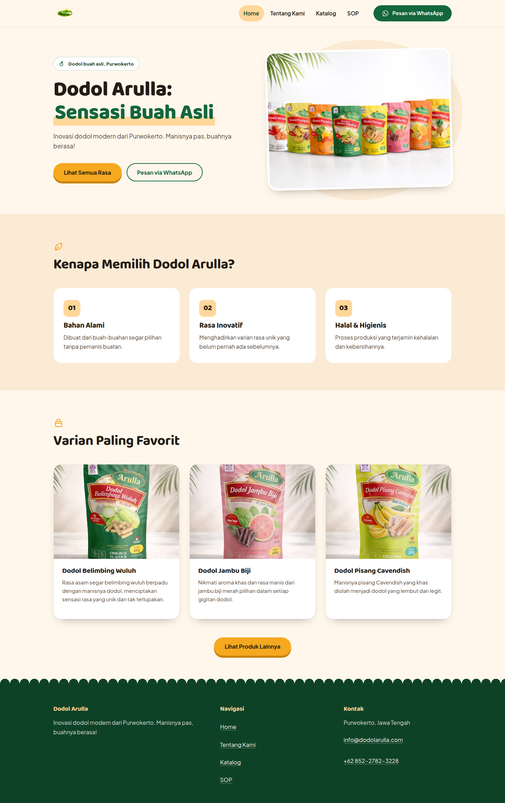 | 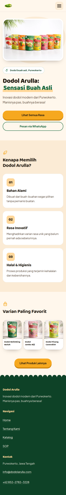 |

**Katalog** — grid seluruh produk, dirender dari satu sumber data.

| Desktop | Ponsel |
|---|---|
| 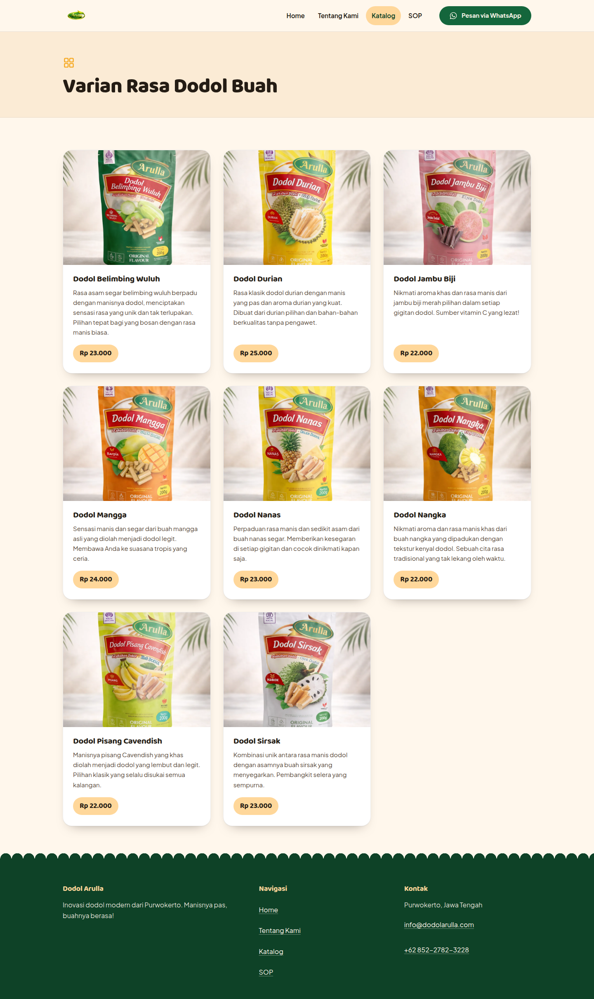 | 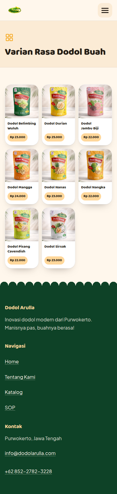 |

**Detail produk** — diambil dari `?id=`, judul dokumen ikut berubah.

| Desktop | Ponsel |
|---|---|
| 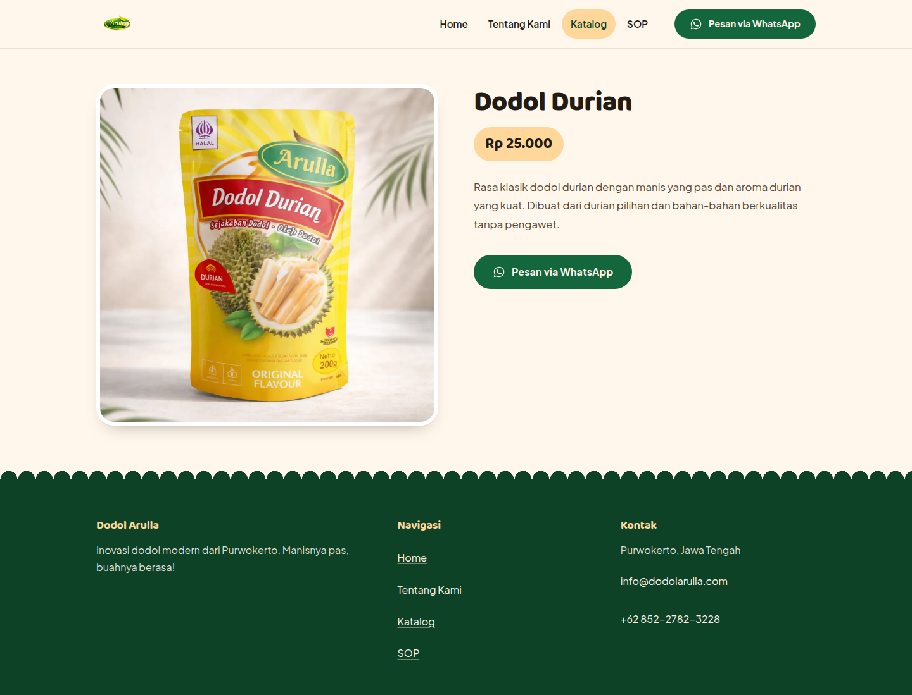 | 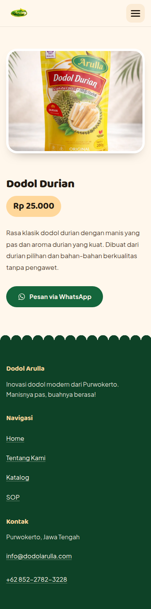 |

**Tentang** — cerita dan visi-misi merek.

| Desktop | Ponsel |
|---|---|
| 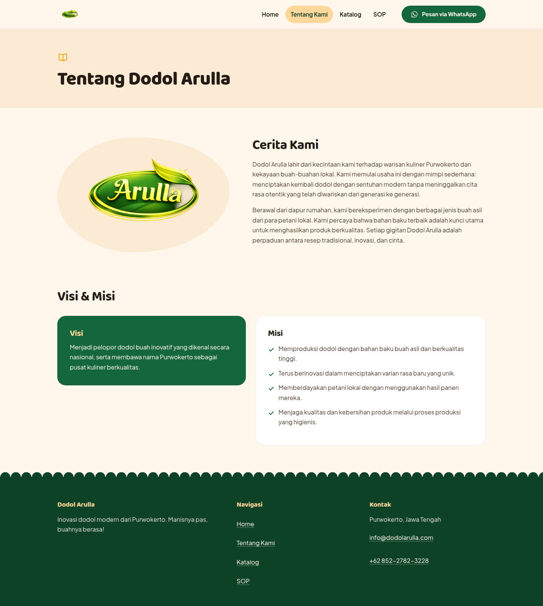 | 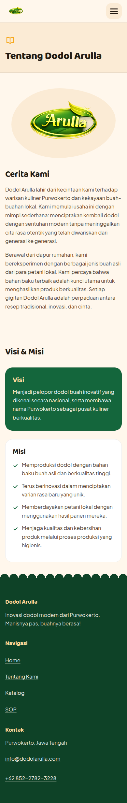 |

**SOP produksi** — 14 langkah, dua kolom seimbang di desktop.

| Desktop | Ponsel |
|---|---|
| 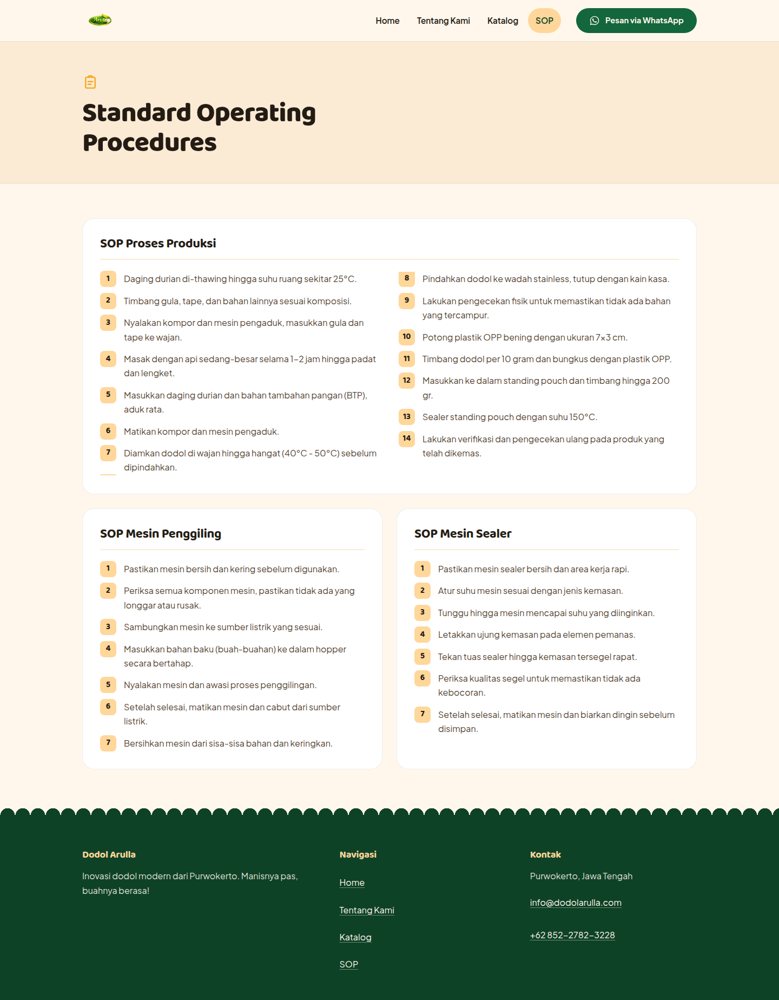 | 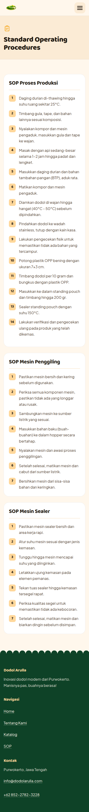 |

---

## Detail yang kelihatan di screenshot

**Grid ponsel 3 kolom.** Diuji pada lebar 320, 360, dan 390px: tidak ada luapan horizontal
dan harga tidak terpotong. Deskripsi disembunyikan di ponsel karena pada ~113px per kartu
teks itu tidak terbaca; nama dan harga tetap lengkap, deskripsi penuh ada di halaman detail.

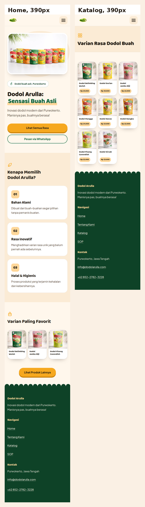

**Ikon digambar sendiri** sebagai SVG, bukan pustaka ikon, supaya bobotnya kecil dan
goresannya konsisten dengan tipografi.

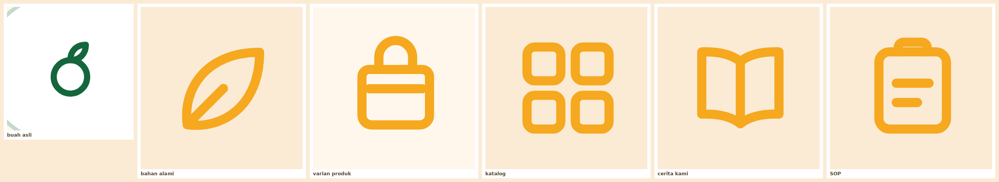

**Target sentuh minimum 44px**, `:focus-visible` 3px yang tidak pernah dihapus, tautan
lewati-ke-konten di setiap halaman, `prefers-reduced-motion` mematikan transisi, satu `h1`
per halaman.

---

## Kepemilikan

Ini proyek berbayar untuk klien. Tangkapan layar ditampilkan sebagai portofolio. Hak atas
kode dapat beralih ke klien sesuai kesepakatan kerja, dan aset merek — foto produk, logo,
teks katalog, dan nama Dodol Arulla — tetap milik klien. Jangan memakai ulang aset merek
untuk keperluan lain.
